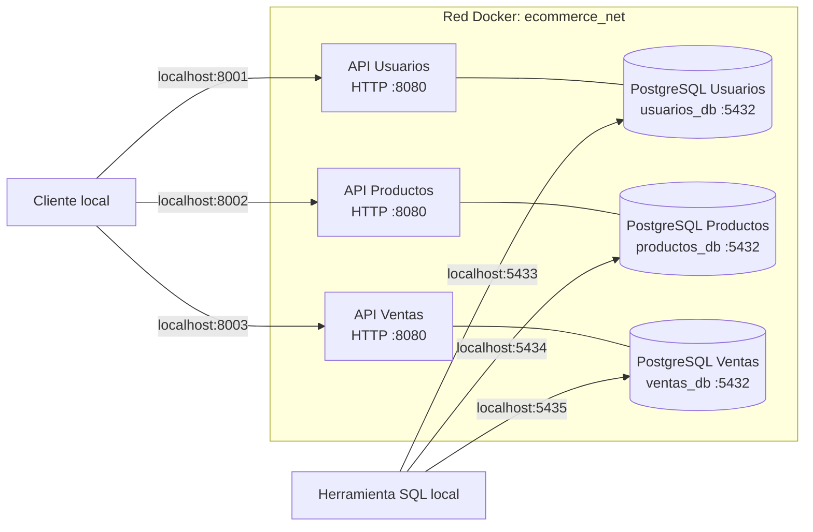

# Arquitectura — Fase 0

El diagrama refleja únicamente los componentes implementados en esta fase. Cada microservicio tiene una base PostgreSQL independiente. Los seis contenedores comparten la red Docker `ecommerce_net`.

En Fase 0 las APIs son placeholders con una ruta HTTP `/health`. Las líneas entre cada API y PostgreSQL del diagrama representan relaciones previstas de la arquitectura; los placeholders todavía no establecen conexiones con las bases de datos. Esa conexión se implementará al desarrollar la lógica de negocio.

## Alcance de usuarios PostgreSQL

El ejercicio exige una base de datos PostgreSQL independiente por servicio y la configuración mediante archivos `.env`, pero no exige usuarios PostgreSQL administrativos separados, roles adicionales ni una configuración de privilegios mínimos. En Fase 0 se mantienen `usuarios_app`, `productos_app` y `ventas_app` tal como están configurados, sin añadir permisos o roles adicionales.
